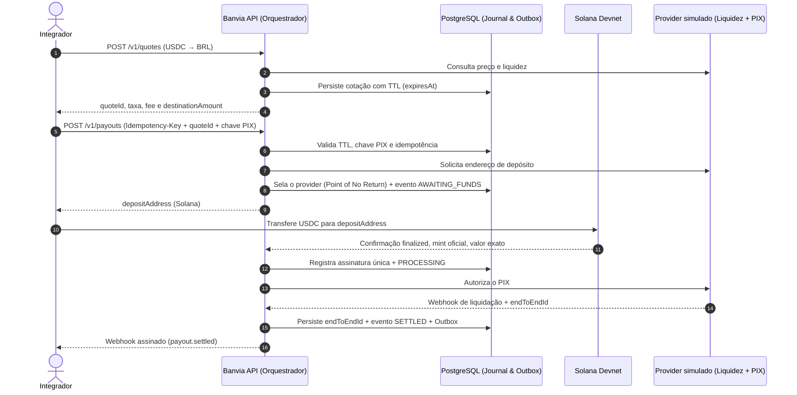

<div align="center">

# ⚡ Banvia

### Infraestrutura de Orquestração Crypto → PIX (Off-Ramp Não-Custodial & API-First)

Converte **USDC** da rede **Solana** em **BRL liquidado via PIX** por meio de uma API única que orquestra provedores regulados, com garantias formais de idempotência, reconciliação e registro probatório imutável.

*Non-custodial USDC → PIX off-ramp orchestrator for businesses. No duplicate PIX, no payout marked settled without an `endToEndId`, even when the provider fails.*

[](https://openjdk.org/projects/jdk/25/)
[](https://spring.io/projects/spring-boot)
[](https://spring.io/projects/spring-modulith)
[](https://www.postgresql.org/)
[](https://redis.io/)
[](https://angular.dev/)
[](https://solana.com/)
[](https://www.bcb.gov.br/estabilidadefinanceira/pix)
[](LICENSE)

[**Escopo do MVP**](docs/requisitos-banvia-mvp-v1.md) · [**Estratégia de Produto**](docs/product-strategy.md) · [**Arquitetura-Alvo (v4.0)**](docs/requisitos-banvia-v4.0.md) · [**ADRs**](docs/adr)

</div>

---

## 🏁 Hack Brasil 2026

Projeto inscrito no [Hack Brasil 2026](https://hackbrasil.com), trilha **Pagamentos & finanças**.

Este repositório foi criado durante a fase online e **todo o código foi escrito do zero a partir de 04/11/2026**. A ideia e a documentação da Banvia já existiam; o código não foi reaproveitado.

A demo roda **só em ambiente de teste**: Solana Devnet, provedores de liquidez simulados e PIX simulado. Não há dinheiro real, dados pessoais reais nem emissão de token.

---

## 📌 Visão Geral e Problema Resolvido

Empresas que operam com stablecoins e precisam liquidar reais (BRL) via PIX enfrentam um ecossistema fragmentado: cada provedor de liquidez tem contrato de API próprio, semântica de erro distinta, política diferente de confirmação on-chain e webhooks que falham em silêncio.

A **Banvia** resolve isso como uma **camada de orquestração B2B, API-First e 100% não-custodial**:

- **Uma única integração REST + Webhooks:** o integrador consome um contrato padronizado, e a Banvia orquestra provedores regulados nos bastidores.
- **Zero custódia:** a Banvia não é exchange, custodiante, emissora de stablecoin nem PSP. Nunca recebe *seed phrase* ou *private key* e não mantém saldo de clientes nem tesouraria própria.
- **Verdade financeira baseada em evidência:** nenhum payout é dado como liquidado (`SETTLED`) por inferência. Exige-se confirmação `finalized` na Solana e o `endToEndId` oficial do PIX, gravados num **journal probatório imutável (append-only)**.

### A tese da demo

> Nenhum PIX em duplicidade, nenhum `SETTLED` sem comprovante, mesmo quando o provedor falha.

---

## 🔄 Fluxo Ponta a Ponta (Crypto → PIX)



---

## 🏛️ Garantias Financeiras

### 1. Idempotência tripla
- **Replay seguro:** mesma chave e mesmo payload devolvem o resultado original, sem reexecutar.
- **Conflito (`409`):** mesma chave com payload diferente é rejeitada.
- **Concorrência:** rajadas paralelas geram exatamente um efeito no provedor, mesmo após restart.

### 2. Incerteza explícita: o estado `UNKNOWN`
*Timeout* não é falha. Se a criação do payout no provedor estoura o tempo, o payout vai para **`UNKNOWN`**, nunca para `FAILED` ou `SETTLED`. Não há retry cego: a resolução é por consulta ativa com a mesma chave.

### 3. *Point of No Return*
Depois que o endereço de depósito é entregue ao cliente, o provedor daquele payout fica **selado**. Falhas posteriores nunca trocam de provedor.

### 4. Identidade monetária e validação on-chain
- Dinheiro é `BigDecimal` no Java e `NUMERIC` no banco. `double` e `float` são proibidos.
- Escala por ativo: `USDC = 6` casas, `BRL = 2`. A identidade `bruto = fee + destinationAmount` fecha no centavo.
- Só depósitos `finalized`, no mint oficial e com valor exato liberam o PIX. Valor a mais ou a menos abre caso de reconciliação.

### 5. Garantias também no banco
A aplicação é a primeira defesa; o PostgreSQL é a última:
- o journal de eventos rejeita `UPDATE`, `DELETE` e `TRUNCATE`;
- `SETTLED` exige `endToEndId` no formato oficial e é terminal;
- o provider selado não muda;
- uma cotação sustenta no máximo um payout.

---

## 🗺️ Roadmap da Demo

- [ ] Base do monorepo: Spring Boot, Angular, Postgres e Redis via compose, CI
- [ ] Schema v4.0 com as garantias no banco
- [ ] Cotação com TTL (`POST /v1/quotes`)
- [ ] Payout, máquina de estados e journal com outbox
- [ ] Idempotência: replay, `409` e concorrência
- [ ] Simulador de provedores, `UNKNOWN`, depósito na Devnet e PIX simulado com `endToEndId`
- [ ] Webhooks de saída assinados (HMAC)
- [ ] Landing page e console da demo
- [ ] Deploy da demo

---

## 🛠️ Stack

| Camada | Tecnologias |
|---|---|
| **Backend** | Java 25, Spring Boot 4.1, Spring Modulith 2.1, Bean Validation |
| **Persistência & Eventos** | PostgreSQL (`ddl-auto: validate`), Flyway, Redis, Transactional Outbox |
| **Frontend** | Angular 21, TypeScript, SCSS |
| **Testes** | JUnit 5, Testcontainers (Postgres e Redis reais), Spring Modulith Test |
| **Blockchain** | Solana Devnet, USDC de teste |

---

## 🚀 Executando Localmente

> Em construção. Os comandos abaixo passam a funcionar quando a base do monorepo estiver pronta.

**Pré-requisitos:** JDK 25, Node.js 24+, Docker com Compose.

```bash
cd backend && ./mvnw test              # testes (Postgres e Redis via Testcontainers)
cd backend && ./mvnw spring-boot:run   # API; sobe a infra pelo compose.yaml
cd frontend && npm install && npm start  # web com proxy para a API
```

| Serviço | Endereço |
|---|---|
| Web | `http://localhost:4200` |
| API | `http://localhost:8080` |
| Healthcheck | `http://localhost:8080/actuator/health` |
| PostgreSQL | `localhost:55432` |
| Redis | `localhost:56379` |

As portas do banco são deslocadas de propósito, para não colidir com instâncias já rodando na máquina.

---

## 📚 Documentação

| Documento | Descrição |
|---|---|
| 🎯 [**Requisitos do MVP v1**](docs/requisitos-banvia-mvp-v1.md) | Escopo enxuto: endpoints, máquina de estados e idempotência |
| 🏗️ [**Arquitetura-Alvo v4.0**](docs/requisitos-banvia-v4.0.md) | Visão de médio prazo: roteamento multi-venue e reconciliação |
| 📜 [**Requisitos v3.3**](docs/requisitos-banvia-ramp-v3.3.md) | Seções que continuam canônicas junto da v4.0 |
| 🧭 [**Product Strategy**](docs/product-strategy.md) | Cenário competitivo, tese B2B, hipóteses e riscos |
| ☁️ [**Trilha AWS**](docs/evolucao-aws.md) | Evolução futura de implantação na AWS |
| 📐 [**ADR 0005 — Off-Ramp Router Provider-First**](docs/adr/0005-offramp-router-provider-first.md) | Orquestrar provedores regulados em vez de custódia própria |
| 📐 [**ADR 0006 — Inversão para B2B API-First**](docs/adr/0006-inversao-b2b-api-first.md) | Foco em infraestrutura B2B via API |
| 📐 [**ADR 0007 — Redução de Escopo do MVP**](docs/adr/0007-reducao-de-escopo-do-mvp.md) | Roteamento por disponibilidade antes de otimização por score |
| 📐 [**ADR 0008 — AWS como Alvo de Implantação**](docs/adr/0008-aws-como-alvo-de-implantacao.md) | AWS em ambiente efêmero, Postgres como fonte de verdade |

---

## 📄 Licença

[MIT](LICENSE)
